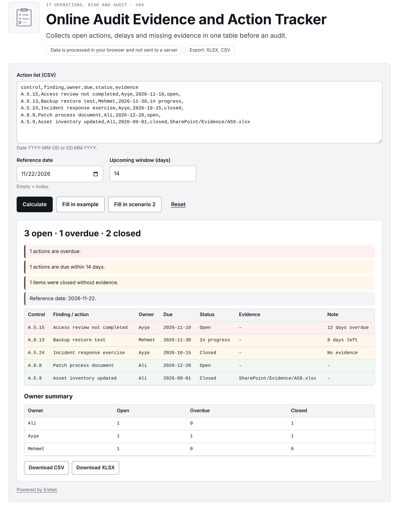

# Audit Evidence and Action Tracker

From an audit findings and corrective action list, extract overdue items, upcoming deadlines, items closed without evidence and status per owner; download as XLSX.

## Try it live

- [Türkçe](https://uyum.eretek.com/araclar/denetim-kanit-aksiyon-takibi)
- [English](https://uyum.eretek.com/en/tools/audit-evidence-tracker)
- [Deutsch](https://uyum.eretek.com/de/werkzeuge/audit-nachweis-tracker)



## What it does

Collects open actions, delays and missing evidence in one table before an audit.

Auditors verify that a closed finding is really closed through evidence; 'closed' items without evidence are raised again. Overdue actions must be explained in management review. The tool checks status, due date and evidence columns and gives a summary per owner.

## Where it helps

Update the list in the weekly security meeting; link treatment plans with the IT Risk Matrix. Keep evidence in an access-controlled library (e.g. SharePoint) with version history.

## How to use it

1. CSV header: `finding, due, status` required; `control, owner, evidence` optional. Status: open/in progress/closed (TR/DE equivalents accepted).
2. Enter the reference date (empty = today) and the number of days counted as upcoming.
3. Press Run; download the list as XLSX.

### Fields

| Field | Description |
|---|---|
| Action list (CSV) | Date YYYY-MM-DD or DD.MM.YYYY. |
| Reference date | Empty = today. |
| Upcoming window (days) |  |

## Example input

Press **Fill in example** in the tool to load this input.

| Input | Value |
|---|---|
| Reference date | `2026-11-22` |
| Upcoming window (days) | `14` |

**Action list (CSV)**

```text
control,finding,owner,due,status,evidence
A.5.15,Access review not completed,Ayşe,2026-11-10,open,
A.8.13,Backup restore test,Mehmet,2026-11-30,in progress,
A.5.24,Incident response exercise,Ayşe,2026-10-15,closed,
A.8.8,Patch process document,Ali,2026-12-20,open,
A.5.9,Asset inventory updated,Ali,2026-09-01,closed,SharePoint/Evidence/A59.xlsx
```

**Expected result:** A.5.15 is 12 days overdue; A.8.13 is due in 8 days; A.5.24 was closed without evidence. 3 open, 2 closed items; Ayşe has 1 overdue action.

## Method and assumptions

Days left = due − reference. For open/in-progress items days left < 0 is overdue, ≤ window is upcoming. Closed items with an empty evidence column get a warning. Statuses recognised: open/açık/offen, in progress/devam/in Bearbeitung, closed/kapalı/erledigt.

## Limits and common mistakes

- Evidence links are not checked for accessibility or content; only whether the column is filled.

## Run it locally

The tool is plain HTML, CSS and JavaScript with no build step and no dependencies.

```bash
git clone https://github.com/eretek/audit-evidence-tracker.git
cd audit-evidence-tracker
node scripts/serve.js        # or: python3 -m http.server 8080
```

Open <http://127.0.0.1:8080/>. Add `?lang=tr` or `?lang=de` for Turkish or German; without it the page follows the browser language and falls back to English. You can also open `index.html` directly from disk.

Run the tests (Node.js 18 or later):

```bash
node test/run.js    # or: npm test
```

The tests run the tool's own fixtures and the worked examples in all three languages without a browser.

## How it works

All processing happens in your browser. The tool makes no network requests, uses no cookies or browser storage, and does not upload files you select.

No server-side component is needed. The version on the Eretek website renders the same page through a private WordPress plugin; that plugin only produces the page markup and is not part of this repository.

| Path | Purpose |
|---|---|
| `index.html` | Page shell |
| `src/app.js` | Builds the page in Turkish, English or German from `src/data.js` |
| `src/data.js` | Field definitions, examples and all texts in three languages |
| `src/core.js` | Shared runtime: validation, number formats, result rendering, CSV/ICS export |
| `src/tool.js` | The calculation or analysis for this tool |
| `docs/screenshot.png` | Screenshot used in this README |
| `src/lib/xlsx.js` | Minimal XLSX writer |
| `src/tools.css`, `src/page.css` | Styles |
| `test/run.js`, `test/cases.json` | Headless tests |

## License and attribution

This tool is released under the [Eretek Website Attribution License](LICENSE). You may use, modify and redistribute it, including commercially. If you make it available on a website or web application, show a visible, clickable credit linking to https://eretek.com/ on every page where the tool is available, for example:

```html
<a href="https://eretek.com/">Powered by Eretek</a>
```

You may add `rel="nofollow"` to the link. Keep the copyright notice and license text in copies and redistributions.
